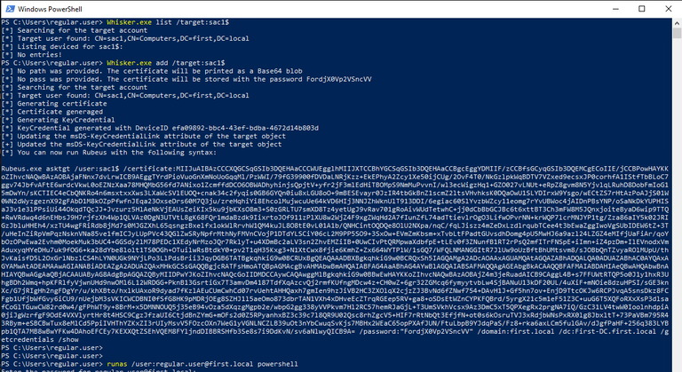

# Shadow Credentials

## Shadow Credentials: A Sneaky Way to Take Over Active Directory Accounts

So, you've probably heard about all those classic Active Directory attacks password spraying, Kerberoasting, DCSync, and whatnot. But here's one that flies under the radar more often than it should: **Shadow Credentials**.

This technique is like adding a backdoor key to someone's account without them ever knowing. And the best part? It's cleaner, quieter, and way more reliable than resetting passwords or hoping for a weak hash to crack.

Let me walk you through what this attack is, how it works, and why it's something every pentester (and defender) should know about.

***

### What Are Shadow Credentials?

In simple terms, **Shadow Credentials** is a technique where an attacker adds alternate login credentials to a user or computer account in Active Directory. These credentials are in the form of certificates, and they let you authenticate as that account using **PKINIT** (Public Key Cryptography for Initial Authentication in Kerberos).

Think of it like this: Instead of stealing someone's password, you're just adding your own key to their account. Now you can log in as them whenever you want, and they won't even know.

<figure><figcaption></figcaption></figure>

***

### A Bit of Background: When Did This Come About?

This attack became possible with **Windows Server 2016**, when Microsoft introduced a feature called **Windows Hello for Business (WHfB)**. WHfB was designed to support passwordless authentication using public-private key pairs stored in the `msDS-KeyCredentialLink` attribute of user and computer objects.

The idea was great for legitimate use no more passwords, just biometrics or PINs. But as security researchers discovered, if you have the right permissions to **write to that attribute**, you can abuse it to take over accounts.

The technique was first highlighted by **Michael Grafnetter** at Black Hat Europe 2019, and later **Elad Shamir** from SpecterOps wrote a detailed breakdown and released a tool called **Whisker** to operationalize it.

<figure><figcaption></figcaption></figure>

***

### How Does It Work?

Alright, let's get into the technical stuff but I'll keep it simple.

#### The Key Ingredient: msDS-KeyCredentialLink

Every user and computer object in Active Directory has an attribute called `msDS-KeyCredentialLink`. This attribute stores **public keys** that can be used for authentication instead of passwords.

When a user enrolls in Windows Hello for Business, their device generates a public-private key pair. The **public key** gets stored in this attribute, while the **private key** stays on the device (usually in a TPM chip).

When they log in, their device uses the private key to prove their identity via **PKINIT**, and the Domain Controller verifies it using the public key in `msDS-KeyCredentialLink`.

#### The Attack

Here's where the abuse happens:

1. **You compromise an account** that has permissions to modify the `msDS-KeyCredentialLink` attribute of a target user or computer.
2. **You generate your own key pair** and add the public key to the target's `msDS-KeyCredentialLink` attribute.
3. **You authenticate as the target** using your private key via PKINIT.
4. **Bonus:** You can even retrieve the target's **NTLM hash** using a special Kerberos ticket.

And just like that, you've taken over the account no password reset, no loud alerts.

<figure><figcaption></figcaption></figure>

***

### The Architecture: PKINIT and Key Trust

Let's break down how PKINIT works in this context.

#### What is PKINIT?

Normally, when you log into a Windows domain, you provide a password. The Domain Controller hashes that password and uses it to decrypt your authentication request. This is **symmetric key** authentication.

**PKINIT** is different it uses **asymmetric cryptography**. Instead of a password, you use a public-private key pair:

* **Client** encrypts the authentication request with their **private key**.
* **Domain Controller** decrypts it with the client's **public key** (stored in AD).
* If it works, the DC sends back a **Ticket Granting Ticket (TGT)**.

<figure><figcaption></figcaption></figure>

#### Key Trust vs. Certificate Trust

There are two models for PKINIT:

* **Certificate Trust**: Uses a full PKI infrastructure with certificates signed by a Certificate Authority (CA). This is common for smartcard authentication.
* **Key Trust**: Introduced with WHfB. Instead of needing a CA, the raw public key is stored directly in the `msDS-KeyCredentialLink` attribute.

Shadow Credentials abuses the **Key Trust** model.

***

### Using Whisker: The Tool That Makes It Easy

Elad Shamir released a C# tool called **Whisker** that automates this entire process. Here's how you'd use it in the real world.

#### Adding Shadow Credentials

```cmd
Whisker.exe add /target:targetuser
```

This command:

* Generates a key pair
* Adds the public key to `targetuser`'s `msDS-KeyCredentialLink` attribute
* Gives you a certificate file and password to use

<figure><figcaption></figcaption></figure>

#### Listing Existing Credentials

```cmd
Whisker.exe list /target:targetuser
```

This shows all key credentials currently stored in the attribute.

#### Removing Shadow Credentials

```cmd
Whisker.exe remove /target:targetuser /deviceid:<GUID>
```

Cleans up after yourself by removing the credential you added.

#### Clearing All Credentials

```cmd
Whisker.exe clear /target:targetuser
```

**Warning:** This nukes all credentials. If the target is legitimately using WHfB, this will break their authentication.

***

### Getting the TGT and NTLM Hash

Once you've added the shadow credential, you use **Rubeus** to authenticate:

```cmd
Rubeus.exe asktgt /user:targetuser /certificate:<base64_cert> /password:"<password>" /domain:example.local /dc:DC01.example.local /getcredentials /show
```

This command:

* Requests a **TGT** for the target user
* Retrieves their **NTLM hash** (which you can use for Pass-the-Hash attacks)

<figure><figcaption></figcaption></figure>

***

### Wait, How Do We Actually Get the NTLM Hash?

This is where things get interesting. You might be wondering: "We just used certificates to authenticate, so how did we end up with a password hash?"

Great question. Let me explain.

#### The Problem: PKINIT Doesn't Use Passwords

When you authenticate using **PKINIT** (with your shadow credentials), you're using a public-private key pair not a password. So technically, you don't have the target user's password or NTLM hash at this point.

But here's the catch: many services in Windows environments still require **NTLM authentication** things like SMB shares, WinRM, and various legacy applications. Microsoft needed a way for passwordless users (like those using Windows Hello or smartcards) to still access these NTLM-only services.

#### The Solution: U2U (User-to-User) Authentication

Microsoft created a mechanism called **User-to-User (U2U) Authentication** to solve this exact problem.

Here's how it works:

**Normal Kerberos Flow:**

* You request a Service Ticket from the KDC to access a service
* The ticket is encrypted with the **service's secret key**
* Only the service can decrypt it (you can't)

**U2U Flow:**

* You request a Service Ticket **to yourself**
* The ticket is encrypted with **your own session key** (which you already have from your TGT)
* Because it's encrypted with your key, **you can decrypt it**

#### The Magic: NTLM Hash in the PAC

When you authenticate using PKINIT, the Domain Controller includes a special structure in your ticket's **PAC (Privilege Attribute Certificate)** called `NTLM_SUPPLEMENTAL_CREDENTIAL`.

This structure contains your **NTLM hash in encrypted form**.

When you request a U2U Service Ticket to yourself and decrypt it, you can extract the PAC and retrieve the NTLM hash from this structure.

<figure><figcaption></figcaption></figure>

#### Step-by-Step: How Rubeus Does It

When you run Rubeus with the `/getcredentials` flag, here's what happens behind the scenes:

**Step 1:** Rubeus performs PKINIT authentication using your shadow credentials

```
-> Sends certificate-based auth request to DC
-> Receives TGT with session key
```

**Step 2:** Rubeus automatically triggers U2U authentication

```
-> Requests a Service Ticket to itself
-> Includes the TGT as an "additional ticket" in the request
-> DC responds with a U2U Service Ticket encrypted with your session key
```

**Step 3:** Rubeus decrypts the U2U ticket

```
-> Uses session key from TGT to decrypt the Service Ticket
-> Extracts the PAC from the ticket
-> Finds NTLM_SUPPLEMENTAL_CREDENTIAL structure in PAC
-> Retrieves NTLM hash
```

**Step 4:** Output shows you the NTLM hash

```
[*] Getting credentials using U2U

  CredentialInfo         :
    Version              : 0
    EncryptionType       : rc4_hmac
    CredentialData       :
      CredentialCount    : 1
       NTLM              : a1b2c3d4e5f6g7h8i9j0k1l2m3n4o5p6
```

#### Why Does This Work?

This technique works because:

1. **Microsoft designed it for backward compatibility** Smartcard and WHfB users need to access NTLM-only services
2. **U2U allows self-decryption** Unlike normal Service Tickets (encrypted with the service's key), U2U tickets are encrypted with your own session key
3. **PKINIT authentication marks the PAC** The `NTLM_SUPPLEMENTAL_CREDENTIAL` is only added to the PAC when PKINIT authentication is used

#### Important Note

You **cannot** use this technique to extract NTLM hashes from just any user. It only works when:

* You've authenticated using **PKINIT** (like with shadow credentials)
* The target account has a certificate or key credential configured
* You have the private key to authenticate

This is why Shadow Credentials is so powerful it gives you both Kerberos TGT access **and** the NTLM hash.

<figure><figcaption></figcaption></figure>

***

### Requirements for the Attack

For this technique to work, you need:

1. **Windows Server 2016 or later** Domain Controller
2. **Windows Server 2016 Functional Level** in AD
3. **A certificate installed on the Domain Controller** (usually automatic if AD CS is deployed)
4. **Permissions to write to `msDS-KeyCredentialLink`** on the target object

That last one is the key. You need an account with delegated rights like `GenericWrite`, `GenericAll`, or `WriteProperty` on the target.

***

### Detection: How to Spot This Attack

Defenders, listen up. Here's how you can catch Shadow Credentials abuse:

#### Event ID 4768 - TGT Request

If PKINIT authentication is rare in your environment, look for **Event ID 4768** where the **Certificate Information** fields are populated.

<figure><figcaption></figcaption></figure>

#### Event ID 5136 - Object Modified

If you have a **SACL** (System Access Control List) configured to audit modifications to user/computer objects, you'll see **Event ID 5136** when `msDS-KeyCredentialLink` is modified.

The subject making the change should be an expected service account (like Azure AD Connect or ADFS). If it's not, investigate.

<figure><figcaption></figcaption></figure>

***

### Prevention: Locking It Down

Here's how to protect your environment:

#### 1. Audit Delegated Permissions

Regularly review who has `GenericWrite`, `GenericAll`, or `WriteProperty` permissions on user and computer objects especially privileged accounts.

#### 2. Deny Write Access to msDS-KeyCredentialLink

Add an **Access Control Entry (ACE)** to **DENY** the principal `EVERYONE` from writing to `msDS-KeyCredentialLink` for accounts not enrolled in WHfB.

This won't stop an attacker with `WriteOwner` or `WriteDACL`, but it raises the bar.

#### 3. Enable Auditing

Configure SACLs to log any modifications to `msDS-KeyCredentialLink`. Monitor those logs closely.

***

### Why This Matters

Shadow Credentials is one of those attacks that's both powerful and stealthy. It doesn't reset passwords, doesn't create noisy computer accounts, and persists even if the target changes their password.

For pentesters, it's a reliable privilege escalation and lateral movement technique. For defenders, it's a reminder that delegation and attribute-level permissions matter just as much as password policies.

***

### Final Thoughts

Active Directory is full of obscure features that can be weaponized. Shadow Credentials is a perfect example a legitimate security feature turned into an attack vector.

If you're on offense, add Whisker to your toolkit. If you're on defense, start auditing those delegated permissions and monitoring for suspicious PKINIT activity.

Stay curious, stay sharp, and always assume someone's looking for that next clever way in.

***

### References

1. https://specterops.io/blog/2021/06/17/shadow-credentials-abusing-key-trust-account-mapping-for-account-takeover/
2. https://www.ired.team/offensive-security-experiments/active-directory-kerberos-abuse/shadow-credentials
