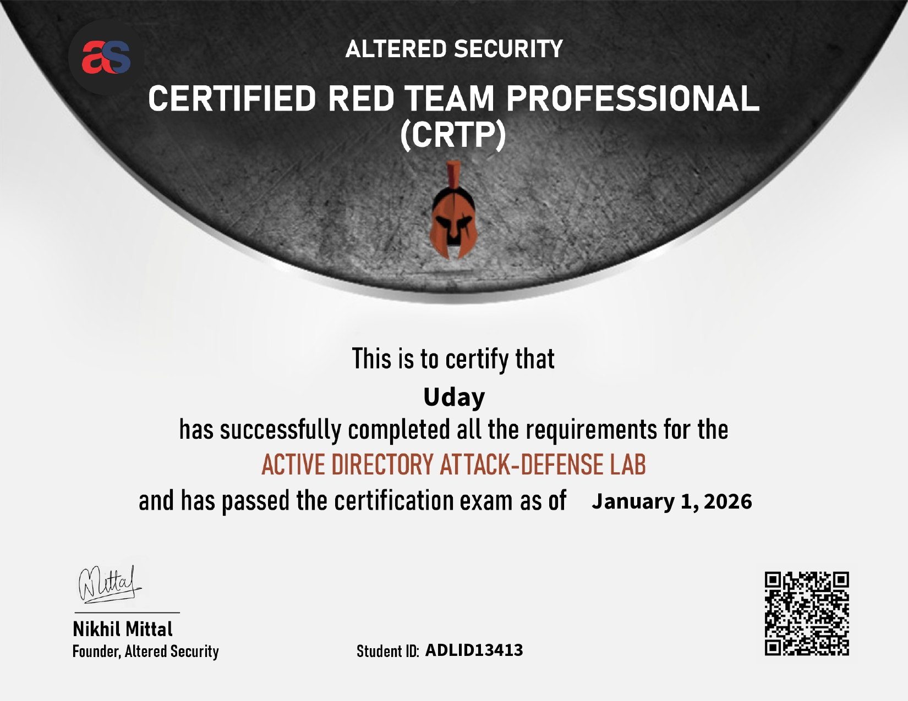

# My CRTP Exam Journey

## My CRTP Journey: How I Went From AD Noob to Certified in 2 Months

### So, I Passed CRTP...

Hey everyone! I recently cleared my CRTP exam and thought I'd share how it all went down. If you're thinking about taking this cert or just getting started with Active Directory pentesting, maybe my story will help you figure out your own path.

<figure><figcaption></figcaption></figure>

### How This Whole Thing Started

I kicked off my AD learning journey on October 1st, 2025. Pretty much everyone I talked to in the community kept saying the same thing - "CRTP is perfect for beginners." And honestly, I was at that stage where I needed something structured to push me forward in AD.

Fast forward to October 15th, and I bought the exam. My logic was simple - nothing motivates you to learn like having an exam looming over your head, right?

### My Prep Strategy (Which Was Kinda Unconventional)

Okay, so here's where I probably did things differently than most people. When I got the course access, I tried watching the videos. I really did. But man, I just couldn't stay engaged. I'm one of those people who learns way better by reading - give me documentation, let me take notes, let me experiment at my own pace. Videos? They just put me to sleep.

So I said screw it and went my own way.

#### What Actually Worked for Me

**HackTheBox was my main thing.** The labs, the modules, all of it. I loved being able to get hands-on immediately and actually see what was happening. Plus, reading through HTB's documentation and write-ups just clicked with my learning style.

**I read. A lot.** Whenever something new popped up, I'd dig into the official docs. Not just skimming - actually understanding why things work the way they do. That depth helped everything make sense later on.

**Pro Labs changed the game for me.** This is where things really started coming together. Pro Labs feel like actual AD environments, not just isolated exercises. And let me tell you, they're scarily similar to what you'll face in the CRTP exam.

#### The Pro Labs I Did

Before my exam, I'd finished three Pro Labs:

1. Zephyr
2. Offshore
3. Klendathu (it's a mini one)

These taught me how to actually think in an AD environment. You know - the whole chain of enumeration, lateral movement, privilege escalation, persistence. All that good stuff.

I also smashed through a bunch of regular HTB labs to keep the fundamentals sharp.

### The Exam: I Took It Way Sooner Than Expected

Here's the wild part - I took my exam just 2 days after getting the lab access.

Why so quick? One of my buddies who's new to cybersec said something that just hit different. He goes, "Dude, at the end of the day, it's just gonna be another Pro Lab for you." And I was like... yeah, you're right. Why am I overthinking this? So I just went for it.

### How the Exam Actually Went

I finished the whole thing in **5 hours and 36 minutes**. Had a stopwatch running the entire time.

#### The Tricky Part

The hardest thing for me wasn't the AD stuff itself. It was doing everything from Windows. I've been living in Linux land for so long that working from a Windows box felt weird. Like, I knew what I needed to do, but my hands weren't used to the tools and the environment. That took some adjusting.

If you're also a Linux person, spend some time getting comfortable with PowerShell and Windows tools before you jump in.

#### The Good Parts

Honestly? The exam felt pretty predictable. I'd guessed two specific attack paths before I even started, and both of them were actually there. It wasn't some magical intuition - just pattern recognition from grinding those Pro Labs.

Everything ran smooth. No weird technical issues, no confusion about objectives. Just pure AD pentesting.

### Is It Worth Taking CRTP?

Yeah, I think so. Let me break down why:

**If you're new to AD**, this exam will push you in the right ways. It's literally designed for people starting out, and it does that job really well.

**For the confidence boost**, there's something about passing an exam that just validates all the hours you put in. You know you can do this stuff now, not just hope you can.

**But let's be real** - at the end of the day, it's a cert. It's a piece of paper saying you know AD pentesting basics. If you've got the cash and time, absolutely go for it. If money's tight, you can learn the same stuff through HTB Pro Labs and save some money.

The real value isn't the PDF certificate you download. It's everything you learn getting there and the confidence it builds.

### What I'd Tell Someone Preparing for CRTP

**Don't force yourself through videos if they bore you to death.** Figure out how you learn best and lean into that.

**Pro Labs are non-negotiable.** Seriously, do them. Zephyr, Offshore, Klendathu - they prepare you better than anything else.

**If you're a Linux person, practice with Windows tools.** Get your PowerShell game up, learn Windows privesc, know your way around the OS. It'll save you headaches during the exam.

**Actually read the documentation.** Don't just skim. When you understand the why behind techniques, everything else falls into place.

**Trust yourself.** If you've put in the work, you're ready. Don't overthink it like I almost did.

**HTB modules are seriously good.** The AD modules are comprehensive and well put together. Use them.

### Wrapping Up

CRTP was a solid milestone for me. It proved I actually know what I'm doing with AD pentesting and gave me the push to tackle harder stuff.

Whether you're just starting or already have some experience, I hope this helps you prep for your own journey. Remember - certs are cool and all, but the real skill comes from the hours grinding in labs, reading docs, and getting your hands dirty with practical work.

Got questions about how I prepped or what the exam was like? Hit me up. And good luck on your CRTP - you've got this!

***

_Exam Cleared: January 2026_\
_&#x50;rep Time: About 2.5 months_\
_&#x45;xam Duration: 5 hours 36 minutes_
